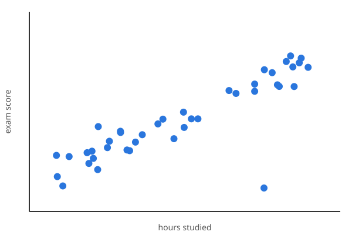

## Join in

Scan to open the poll page (or press **Shift+Q** at any time).

::: {.poll-qr size="300"}
:::

# Every question type

## A poll with an answer

::: {.poll #capital}
- [ ] Sydney
- [x] Canberra
- [ ] Melbourne
- [ ] Perth
:::

::: {.notes}
`- [x]` marks the answer. Space reveals it: the right row turns green, and the
phones show it too. With the quiz on, right answers score points.
:::

## Results hidden until the reveal

::: {.poll #pvalue results="hidden"}
A p-value of 0.03 means:

- [ ] There is a 3% chance the null hypothesis is true
- [x] Data this extreme would occur 3% of the time if the null were true
- [ ] There is a 97% chance the result is real
:::

::: {.notes}
results="hidden": the votes are counted but the bars stay hidden, so the room
isn't swayed by them. Space shows the results, then the answer.
:::

## Pick every prime

::: {.poll #primes max-choices="3"}
- [x] 2
- [x] 3
- [ ] 9
- [x] 11
:::

::: {.notes}
max-choices="3": phones get toggles and a Submit button; the bars show the
share of people who picked each option.
:::

## Peer instruction

::: {.poll #ci rounds="2" timer="60"}
A 95% confidence interval for a mean is (4.1, 5.3). Which is right?

- [ ] There is a 95% chance the true mean is in (4.1, 5.3)
- [x] 95% of intervals built this way contain the true mean
- [ ] 95% of the data lie in (4.1, 5.3)
:::

::: {.notes}
Vote, talk to your neighbour, vote again. The minute's timer moves on to round
2 by itself (or press space); round 2's bars show where round 1 was. Shift+T
pauses the timer.
:::

## How many?

::: {.estimate #beans min="0" max="1000" answer="412" tolerance="10%"}
How many jelly beans are in the jar?
:::

::: {.notes}
A histogram of the guesses and their median; space draws the answer.
tolerance="10%" is what counts as right in the quiz.
:::

## What should we revisit?

::: {.rank #revisit top="3"}
Put your top three in order.

- Sampling distributions
- Confidence intervals
- Hypothesis tests
- Power
- Regression
:::

## Spot the outlier

::: {.hotspot #outlier answer="0.75,0.80,0.05"}
Tap the point that does not fit.


:::

::: {.notes}
A heat map of the taps. answer="x,y,radius" (fractions of the image's width
and height) is the circle space reveals.
:::

## Draw your guess

::: {.sketch #rt x="20,80" y="200,600" x-label="Age" y-label="Reaction time (ms)" answer="20:250, 40:280, 60:340, 80:450"}
How does reaction time change with age?
:::

::: {.notes}
Phones draw a curve with a finger. The slide shows every curve, the class
median and the middle half; space reveals the real data (dashed) and how many
came close.
:::

## How confident are you running a t-test in R?

::: {.likert #confidence scale="0-10" low="Not at all" high="Completely"}
:::

## How was the pace?

::: {.likert #speed labels="Too slow|Just right|Too fast"}
- Pace of today's lecture
:::

## Your questions

::: {.qa}
:::

::: {.notes}
Phones have a Questions tab all session: ask, and upvote others' questions.
The presenter's panel can mark them answered, hide them, or show one full
screen. `livepoll: qa: moderated` holds each for approval first.
:::

## Leaderboard

::: {.leaderboard}
:::

::: {.notes}
With `livepoll: quiz: true` (this deck's YAML) the phones ask for a nickname,
and each revealed answer scores. Rename gives a player a neutral name.
:::

# Classic layout and charts

## A classic poll

::: {.poll #measure layout="classic"}
A bathroom scale that always reads 3 kg too heavy is:

- [x] reliable but not valid
- [ ] valid but not reliable
- [ ] neither
- [ ] both
:::

::: {.notes}
Buttons here, the chart on the next slide. `- [x]` marks the correct answer.
:::

## Results: the defaults

::: {.poll-results for="measure" show-question="true"}
:::

::: {.notes}
Space reveals the answer: the correct bar turns green, and the phones show it.
:::

## Results: vertical, styled

::: {.poll-results for="measure" orientation="vertical" font-size="18" color="#444" grid-color="#eee" label-wrap="14" height="420px"}
:::

::: {.notes}
orientation="vertical" puts the options along the bottom; font-size sets all
the chart's text, color and grid-color the text and grid lines, label-wrap
wraps long options, height the chart's height.
:::

## A poll without letters

::: {.poll #pace layout="classic" question="How was the pace of this session?"}
- [too slow]{value="too slow"}
- [just right]{value="just right"}
- [too fast]{value="too fast"}
:::

::: {.notes}
Giving every option a value drops the A. / B. / C. letters.
:::

## Results: per-axis sizes

::: {.poll-results for="pace" x-tick-size="14" y-tick-size="26" color="#444"}
:::

::: {.notes}
x-tick-size and y-tick-size size the bottom and the left axis separately: here
small counts along the bottom and large options down the side.
:::

## A classic rating scale

::: {.likert #course layout="classic" scale="agree-5"}
- The readings were relevant to the lectures
- The live polls helped me check my understanding
- The pace of the course was about right
:::

## Rating results: the defaults

::: {.poll-results for="course"}
:::

::: {.notes}
A stacked bar per statement, the legend underneath.
:::

## Rating results: vertical, legend right

::: {.poll-results for="course" orientation="vertical" legend="right" legend-size="13" x-tick-size="18" label-wrap="16" color="#444"}
:::

::: {.notes}
legend takes top / bottom / left / right / false, legend-size its text size.
Polls have no legend: a poll chart is one unnamed set of bars.
:::

## A numeric scale

::: {.likert #useful layout="classic" scale="1-5" low="Not useful" high="Very useful"}
How useful was today?
:::

## Numeric results: legend on top

::: {.poll-results for="useful" legend="top" font-size="20" color="#444"}
:::

::: {.notes}
A numeric scale needs its legend to say which shade is which number.
legend="false" hides it, for a chart that reads without one.
:::

## A classic word cloud

::: {.wordcloud #oneword layout="classic" max-words="1" height="320px"}
Describe today in one word.
:::

## Deck-wide chart defaults

Every option above also goes in `_quarto.yml`, for all charts at once; a
chart's own attributes still win:

```yaml
livepoll:
  chart:
    color: "#444"
    font-size: 18
```

Polls, rating scales and word clouds take `layout="embedded"` instead for
everything on one slide (the template's default): see part 1, and `week.qmd`.
